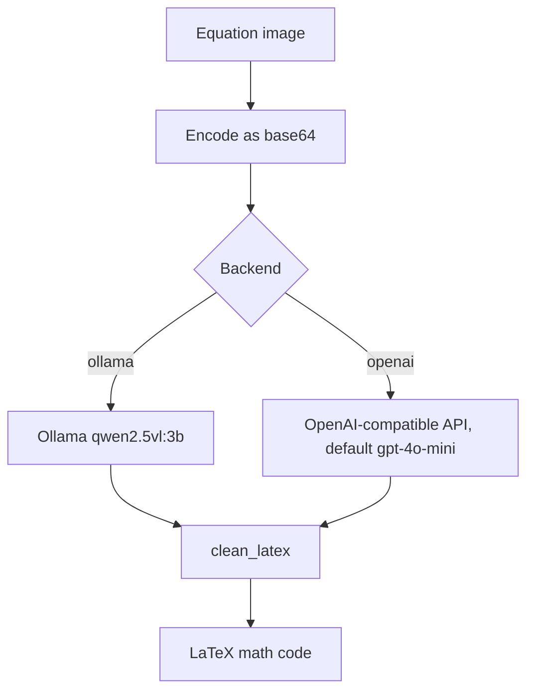
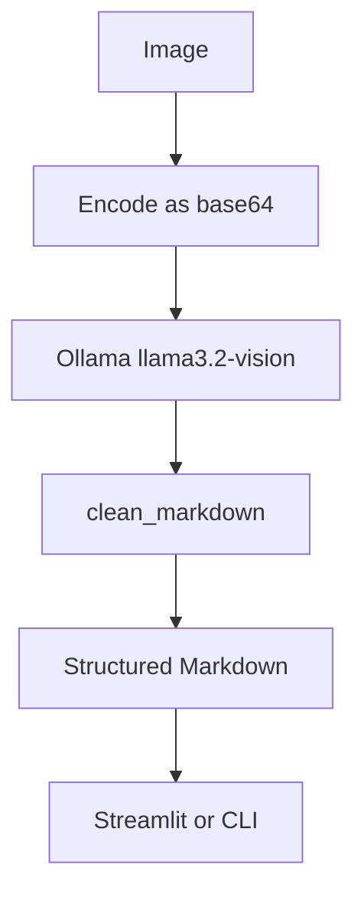
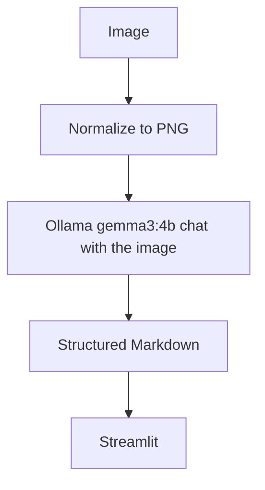
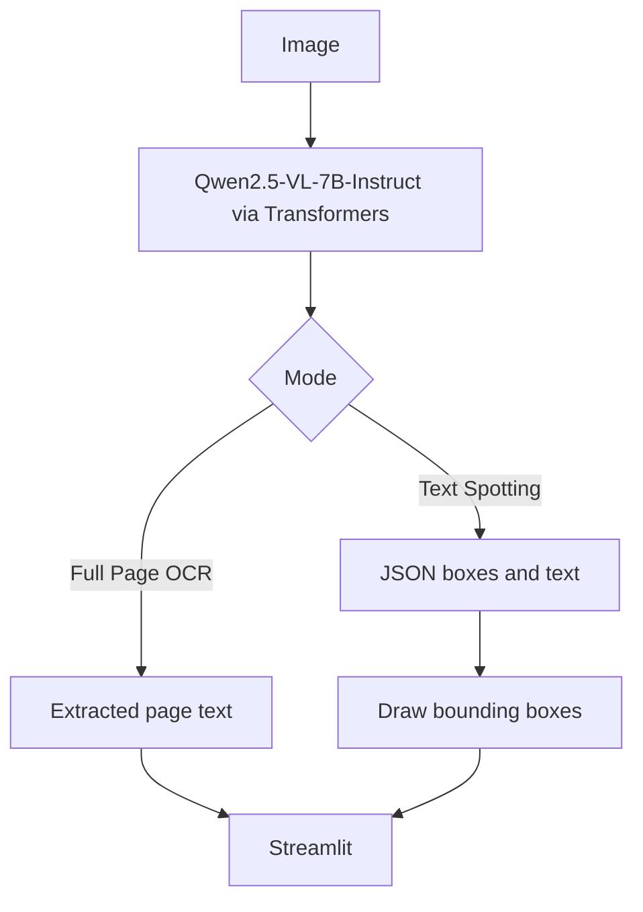

# OCR and Vision Projects

A collection of computer-vision and OCR tools. Each project lives in its own folder with its own dependencies and documentation.

## Projects

| Project | Description |
|---------|-------------|
| [OCR LATEX](OCR%20LATEX/README.md) | Convert images of mathematical equations into LaTeX using vision models |
| [LLAMA OCR](LLAMA%20OCR/README.md) | 100% local image-to-Markdown OCR with Llama 3.2 Vision and Streamlit |
| [GEMMA OCR](GEMMA%20OCR/README.md) | 100% local, private structured OCR with Google's Gemma-3 vision model and Streamlit |
| [QWEN OCR](QWEN%20OCR/README.md) | Local OCR and text spotting with Qwen 2.5 VL via Hugging Face Transformers |

## How it works

### OCR LATEX



### LLAMA OCR



### GEMMA OCR



### QWEN OCR



## Repository layout

```
OCR-AND-VISION-PROJECTS/
├── OCR LATEX/          # LaTeX OCR from equation images
├── LLAMA OCR/          # 100% local image-to-Markdown OCR (Llama 3.2 Vision)
├── GEMMA OCR/          # 100% local structured OCR (Gemma-3 Vision)
├── QWEN OCR/           # Local OCR & text spotting (Qwen 2.5 VL)
└── README.md           # This file
```

Each subproject has its own `README.md`, `requirements.txt`, and `.gitignore`. Install and run from inside the project folder you care about.
